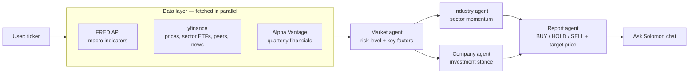

<p align="center">
  
</p>

<h1 align="center">Solomon Financial Research</h1>

<p align="center">
  <b>An AI agent that does top-down equity research — Macro → Industry → Company — and writes a BUY / HOLD / SELL report in about a minute.</b><br>
  <a href="https://solomon-financial-research.streamlit.app"><b>▶ Live demo</b></a>
</p>

---

## Why I built it

Individual investors usually jump straight to a single stock's chart and skip the context a professional analyst would check first: *Is the macro backdrop risky? Is this sector gaining or losing momentum? Is this company cheap relative to its peers?*

Solomon automates that **top-down workflow**. Type a ticker or company name, and three specialized AI agents analyze the market, the industry and the company in sequence — each one passing its conclusions to the next — before a final agent synthesizes everything into an investment report you can question in chat.

Built as my graduation project at Peking University (Yuanpei College, Big Data Management & Application), Aug 2025 – Jul 2026, and deployed on Streamlit Community Cloud.

<!-- Screenshots: add 2–3 images to assets/ and uncomment
<p align="center">
  
</p>
-->

## What it does

| Tab | What you get |
|---|---|
| **Macro** | Market regime from FRED indicators (Fed funds, CPI, unemployment, 2Y/10Y yields, yield-curve spread), VIX and the Fear & Greed Index. The agent picks the 3–5 factors that matter *right now* and chooses how to visualize each. |
| **Industry** | Sector ETF relative strength vs. the S&P 500 and peer comparison (P/E, forward P/E, operating margin). |
| **Company** | Fundamentals, valuation, analyst consensus, price performance and charts. |
| **News** | Latest market, sector and company headlines. |
| **AI Report** | Final verdict (BUY / HOLD / SELL), conviction, target price *with its valuation basis*, investment thesis, key risks — plus **"Ask Solomon"** chat grounded in the report. |

## How it works



- **Top-down chaining.** The market agent's conclusions are passed into the industry and company agents, so a "high macro risk" judgment actually shapes the downstream analysis instead of each agent working in isolation.
- **Structured outputs.** Every agent returns a fixed JSON schema (summary, risk/momentum/stance label, key points with importance). The UI renders directly from these fields, so the LLM never produces free-form text the app has to parse.
- **The agent decides what to show.** For each macro factor the market agent chooses a visualization — a FRED time-series chart, a news image, or text only — instead of filling a fixed template.
- **Grounded numbers.** Prompts are built from the fetched data (prices, multiples, peer medians), and the report must state the methodology behind any target price.

## Engineering decisions

**Why a fixed pipeline, not a free-roaming agent.** Equity research has a natural order (macro → sector → stock), and a fixed chain makes every report comparable and debuggable. The trade-off is flexibility: a question like "how is the semiconductor sector doing?" still runs all three stages. An orchestrator that routes questions to only the needed agents is the next step (see roadmap).

**Two model tiers.** A smaller model handles the three stage analyses; a larger model writes the final report and chat answers, where reasoning quality matters most. This keeps cost and latency down without weakening the verdict.

**Resilient to data-source outages.** In October 2026 Yahoo changed the endpoint behind `yfinance`'s `Ticker.news`, and news came back empty for every symbol. Solomon's news loader now falls back automatically: `Ticker.news` → `yf.Search` → Yahoo Finance RSS, normalizing all three into one format.

**Safe to run in public.** The app calls a paid LLM API on every analysis, so it enforces per-session and global daily caps for analyses, reports and chat messages (configurable through Streamlit Secrets). API keys load from `.env` locally and Streamlit Secrets in the cloud, from a single settings module.

**Fast enough to use.** Market, industry and company data load in parallel, and data calls are cached with TTLs to avoid hitting rate limits on repeat lookups.

## Tech stack

**App** Streamlit · **LLM** OpenAI API (JSON mode) · **Data** yfinance, FRED API, Alpha Vantage · **Charts** Plotly, Altair · **Language** Python

## Run locally

```bash
python -m venv .venv
source .venv/bin/activate          # Windows: .venv\Scripts\activate
pip install -r requirements.txt

cp .env.example .env               # then add your API keys
streamlit run src/app/streamlit_app.py
```

| Variable | Get one at |
|---|---|
| `OPENAI_API_KEY` | https://platform.openai.com/api-keys |
| `FRED_API_KEY` | https://fred.stlouisfed.org/docs/api/api_key.html |
| `ALPHA_VANTAGE_API_KEY` | https://www.alphavantage.co/support/#api-key |

## Project structure

```
src/
├── app/            # Streamlit entry point
├── config/         # Settings, API keys, usage limits, ticker search
├── data_loader/    # Market / industry / company / news loaders
├── llm/            # Market, industry and company agents + report generator
├── charts/         # Plotly / Altair chart builders
└── ui/             # Tab renderers and report section
notebooks/          # Agent-by-agent experiments
tests/              # Loader and LLM tests
```

## Roadmap

- [ ] **Orchestrator agent** — route each question to only the agents it needs
- [ ] **Backtest the verdicts** — compare past BUY / SELL calls against realized returns
- [ ] **Korean equities** (KOSPI / KOSDAQ) for domestic retail investors
- [ ] Accounts and watchlists

## Disclaimer

Solomon is a research and learning project. Its reports are generated by AI for informational purposes only and are not investment advice.
